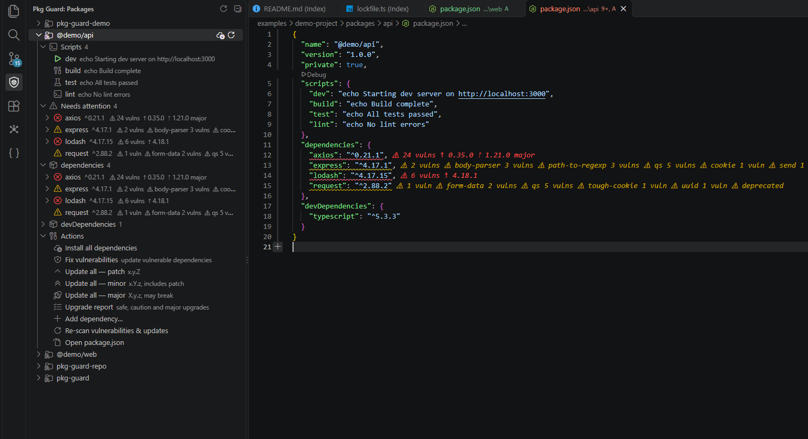

# Pkg Guard

Vulnerability warnings and update suggestions right inside your `package.json`, including **transitive** dependencies, with safe one-click fixes. Available for VS Code and the JetBrains IDEs (WebStorm, IntelliJ IDEA, …).



## Features

- **Inline warnings** next to each dependency: known vulnerabilities, newer patch / minor / major versions.
- **Import warnings**: the same vulnerability warnings on the `import` / `require` lines of vulnerable packages in JS and TS files.
- **Transitive vulnerabilities** from `yarn.lock` (v1) or `package-lock.json`, shown on the direct dependency that pulls them in.
- **One-click fixes**: update to the fixed version, pin a transitive package via `resolutions` / `overrides`, ignore an advisory.
- **Compatibility check** before an update: peer dependencies, `engines.node`, and companion updates for packages that would break.
- **Changelog** between your installed version and the target.
- Works with npm, yarn, pnpm and bun. Advisories come from [OSV.dev](https://osv.dev), versions from the npm registry.

## Install

| IDE | Package | Guide |
|---|---|---|
| VS Code | `.vsix` | [platforms/vscode](platforms/vscode) |
| WebStorm / IntelliJ IDEA | plugin `.zip` | [platforms/jetbrains](platforms/jetbrains) |

Fixes only edit `package.json`; run your package manager afterwards to refresh the lockfile.

## Repository layout

| Folder | Contents |
|---|---|
| [`src/`](src) | Shared TypeScript logic and the JSON-RPC sidecar used by every platform |
| [`platforms/vscode/`](platforms/vscode) | VS Code extension |
| [`platforms/jetbrains/`](platforms/jetbrains) | WebStorm / IntelliJ plugin (Kotlin) |
| [`docs/media/`](docs/media) | Demo GIFs used in the READMEs |
| [`examples/demo-project/`](examples/demo-project) | Intentionally out-of-date monorepo used to record those GIFs |
| `output/` | Build artifacts (git-ignored) |

A new IDE or language gets its own folder under `platforms/` and reuses `src/`.

### Shared engine (`src/`)

| Folder | Purpose |
|---|---|
| `types/` | Shared type definitions, one file per domain |
| `versions/` | Semver, range matching and bump targets (pure, no I/O) |
| `manifest/` | package.json parsing and editing, package-manager detection |
| `sources/` | npm registry, changelog, OSV, audit output and lockfile graphs |
| `analysis/` | Scan, findings, compatibility, fixes and the upgrade report |
| `imports/` | Locating package imports in JS/TS source and matching them to findings |
| `test/` | Unit tests |

- `src/server.ts` is a Node sidecar speaking line-delimited JSON-RPC over stdin/stdout (`scan`, `fixEffect`, `rangeEdits`, `importFindings`, `compat`, `changelog`, `repoUrl`, `clearCache`). A new IDE or language integration only needs to spawn it and speak this protocol.
- `yarn cli core build:server` writes the bundled sidecar to `dist/sidecar/server.js`; `yarn cli core test` runs the unit tests.

## Development

```bash
# install all root and VS Code workspace tools once
yarn install

# shared logic + tests
yarn cli core test

# VS Code extension -> output/vscode/*.vsix
yarn cli vscode package

# build the extension and install it into VS Code (replaces the installed copy)
yarn cli vscode install

# JetBrains plugin -> output/jetbrains/*.zip
cd platforms/jetbrains && ./gradlew buildPlugin
```

`yarn cli vscode install` runs the `code` command (falling back to `code-insiders`). Pass `--editor <command>` to use another one, or `--profile <name>` to install into a specific VS Code profile. Reload the window afterwards (*Developer: Reload Window*). To try unreleased code without installing, open `platforms/vscode` in VS Code and press F5.

### Versions

All versions live in [`version.yml`](version.yml): the product version, minimum VS Code, Node bundle target, and the JetBrains `sinceBuild`, IDE version and JVM.

```bash
yarn cli                         # choose a repository task interactively
yarn cli version 0.2.0           # set the product version and stamp every platform
yarn cli version                 # re-sync after editing version.yml
yarn cli version --check         # fail if a file is out of sync
```

When adding a platform, add it to the targets list in `scripts/cli.js`. The Kotlin and IntelliJ Gradle plugin versions stay in `platforms/jetbrains/build.gradle.kts` because the `plugins {}` block can't read properties.

## Contributing

Issues and pull requests are welcome. Read [CONTRIBUTING.md](CONTRIBUTING.md) first for how to report bugs, set up the project and submit changes.

## License

[MIT](LICENSE)
