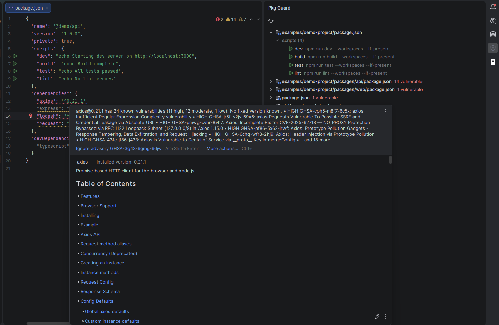

# Pkg Guard for JetBrains IDEs

Vulnerability warnings and update suggestions right inside `package.json`, including transitive dependencies. For WebStorm, IntelliJ IDEA and other JetBrains IDEs (build 242+).



## Features

- **Annotations** on each dependency: known vulnerabilities and newer patch / minor / major versions.
- **End-of-line hints** like `⚠ 3 vulns → 4.18.1` on dependency lines, colored by severity.
- **Import warnings** in JS / TS files: vulnerable packages are flagged on their `import` / `require` lines, with an end-of-line hint.
- **Alt+Enter fixes**: update to the fixed version, pin a transitive package via `resolutions` / `overrides`, ignore an advisory, open the advisory in the browser.
- **Transitive vulnerabilities** from `yarn.lock` (v1), `package-lock.json`, `npm-shrinkwrap.json` or `pnpm-lock.yaml`, shown on the direct dependency that pulls them in. bun lockfiles are not read yet; a project that has one gets no transitive checks, and the scan notes say so.
- **Pkg Guard tool window** (right side): every `package.json` with its dependencies, update to latest or a chosen version (only newer versions are offered), changelog, run scripts. It also has:
  - a **Needs attention** group of the dependencies with a vulnerability, deprecation or out-of-sync install;
  - **Notes** per project: unsupported lockfile, dependencies not checked, the data source of the last scan;
  - project actions **Add dependency…**, **Fix vulnerabilities** (updates and pins every vulnerable dependency after a confirmation), **Re-scan this project**, and **Remove dependency…** on a dependency;
  - under each dependency, the newer versions with **Changelog** (installed to that version, or that version only);
  - a message with what Pkg Guard needs when the project has no `package.json`.
- **Status bar widget**: vulnerable and update counts over the project's `package.json` files (the tooltip names the data source); click to re-scan with fresh data. **Pkg Guard: Re-scan** is also in *Find Action*.
- **Compatibility check** before an update: peer dependencies, `engines.node`, and companion updates.
- **Settings page** under *Settings | Tools | Pkg Guard*.

## Requirements

Node.js 24 or newer on the machine. If it is not found automatically, set its path in *Settings | Tools | Pkg Guard*.

## Install

Download the plugin `.zip`, then *Settings | Plugins | ⚙ | Install Plugin from Disk…*.

## Build from source

```bash
# From the repository root, install the shared toolchain once with `yarn install`.
yarn cli jetbrains build    # zip lands in output/jetbrains/
yarn cli jetbrains run      # sandbox IDE
yarn cli jetbrains verify   # plugin verifier
```

The plugin bundles the shared scanner (`src/`) as a Node sidecar; the Gradle build runs `yarn cli core build:server` from the repository root. See the [repository README](../../README.md) for the layout and versioning.
